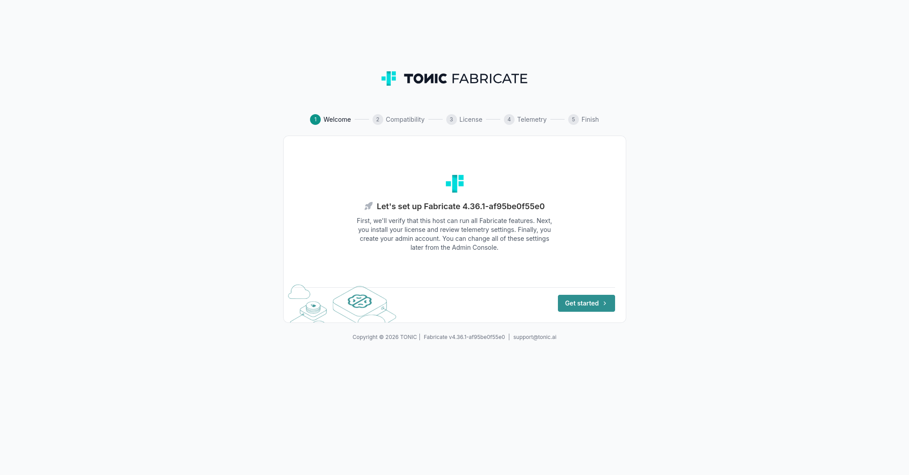
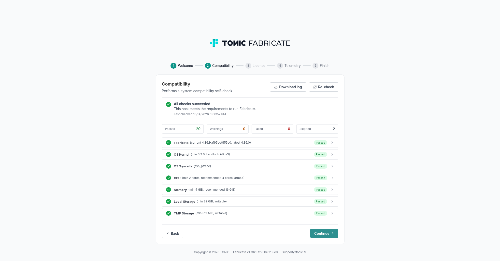

## Tonic Fabricate (Helm + Terraform)

This repository contains a Helm chart that deploys Fabricate (web, worker, PDF sidecar, postgresql - optional, redis - optional), and optional Terraform templates for common cloud providers that provision all the required resources.

| Cloud Provider | Resources Terraform creates |
|----------------|----------------------------------|
| **AWS** | EKS cluster, ALB, RDS, ElastiCache, S3, Bedrock API key, SES, IAM roles, CloudWatch logs |
| **GCP** | GKE Standard cluster, PostgreSQL and Redis |

#### Repository layout

```
Chart.yaml, templates/                             Helm chart (the chart root is the repo root)
values.example.yaml                                Chart default values (committed)
values.yaml                                        Your local copy of the defaults (gitignored, see below)
terraform/                                         Terraform root module (cluster + Helm releases)
terraform/aws/, terraform/gcp/                     Cloud modules (selected by the `cloud` variable)
terraform/aws.tfvars.example, gcp.tfvars.example   Variables templates
```

## Requirements

- [Terraform](https://developer.hashicorp.com/terraform/install) ≥ 1.15
- [Helm](https://helm.sh/docs/intro/install/) 3.x
- [kubectl](https://kubernetes.io/docs/tasks/tools/) (also used by Terraform to wait for the load balancer)
- [AWS CLI v2](https://docs.aws.amazon.com/cli/latest/userguide/getting-started-install.html) (for AWS) or [Google Cloud CLI](https://cloud.google.com/sdk/docs/install) `gcloud` (for GCP)
- Quay pull credentials for the Fabricate images (username and password, provided by the Tonic Sales team)

## Fabricate Requirements
- Minimum: 2 CPU cores (amd64/arm64), 4 GiB RAM, 32 GiB disk space
- Persistent block volume for web and worker containers (EBS on AWS)
- Cluster/Pod SecurityContext policy that allows the `SYS_PTRACE` capability
- Cluster nodes with Linux kernel 6.2+ and Landlock ABI v3 support (on AWS: EKS with EC2 nodes, not Fargate)
- SMTP server for outgoing emails (on AWS Amazon SES)
- AI provider (Anthropic, OpenAI, Amazon Bedrock, Azure AI Foundry, Gemini Enterprise Agent Platform)

## Deployment

- [Deploy to AWS EKS](#deploy-to-aws)
- [Deploy to GCP GKE](#deploy-to-gcp)
- [Deploy Helm to an existing K8s cluster](#deploy-helm-to-an-existing-k8s-cluster)

## Deploy to AWS

### 1. Authenticate and choose the region

```bash
aws configure                      # or: aws sso login --profile <profile>
aws sts get-caller-identity        # confirm the right account (avoid the root user)

export AWS_REGION=us-east-1        # must equal region in terraform.tfvars
```

By default the cluster, RDS and ElastiCache use the account's **default VPC** (it must exist). To use another VPC set `vpc_id` (and optionally `vpc_subnet_ids`, in at least two AZs). If you don't set `vpc_subnet_ids`, two subnets in two EKS-supported AZs are chosen automatically. **No NAT gateway is created**: nodes get IPs from the subnets, so custom subnets must auto-assign IPs and route to an internet gateway.

### 2. Copy Terraform variables template

```bash
cp terraform/aws.tfvars.example terraform/terraform.tfvars
```

Edit region and cluster name in `terraform.tfvars` if needed:

```hcl
cloud   = "aws"
region  = "us-east-1"
cluster = "fabricate-eks"
```

You don't need to set database, Redis, S3 or Bedrock values: Terraform generates and wires them for you.

By default the cluster, RDS and ElastiCache use the account's **default VPC** (it must exist). To use another VPC set `vpc_id` (and optionally `vpc_subnet_ids`, in at least two AZs). If you don't set `vpc_subnet_ids`, two subnets in two EKS-supported AZs are chosen automatically. **No NAT gateway is created**: nodes get IPs from the subnets, so custom subnets must auto-assign IPs and route to an internet gateway.
NOTE: If you don't want to use RDS and ElastiCache, set `enable_rds = false` and `enable_elasticache = false` in `terraform.tfvars`. Terraform then deploys PostgreSQL and Redis as pods with Helm into the EKS cluster. If you want to use a different ingress controller instead of the ALB, set `enable_alb = false` too.

### 3. Copy Helm chart values template

```bash
cp values.example.yaml values.yaml
```

`values.yaml` holds the chart settings.
The Helm chart stores all the provided env variables and secrets in Kubernetes Secrets and updates them on each deploy when they're non-empty. Values that are empty keep the value stored in the Secret by the previous deploy.

Set the Quay.io pull credentials in `values.yaml` on the first deployment to populate them into the Secrets, or put them into the Secrets manually:
NOTE: You can delete the secret values once the first deployment succeeds. Don't commit `values.yaml` or store secrets in files you share.

```yaml
registry:
  username: "<username>"
  password: "<password>"
```

Set your domain and admin email settings under `env` in `values.yaml`:

```yaml
env:
  FABRICATE_HOST: "fabricate.example.com"      # the domain you will use; you point its DNS at the ALB in step 5
  FABRICATE_ADMIN_EMAIL: "admin@fabricate.example.com"   # becomes the admin after sign-up
```

### 4. Provision cluster and deploy Fabricate

```bash
terraform init -upgrade
terraform plan
terraform apply
```

The first provisioning and deployment takes roughly 20–30 minutes (EKS, RDS and ElastiCache are the slow parts).
Terraform then waits for the ALB and checks that the workloads become ready.

When the apply succeeds, Terraform prints the outputs.
The one you need is `fabricate_ingress_address`: the DNS name of the load balancer (ALB) that serves Fabricate.

```
Outputs:

fabricate_ingress_address   = "k8s-fabricat-fabricat-xxxxxxxxxx-xxxxxxxxxx.us-east-1.elb.amazonaws.com"
```

NOTE: Sensitive values are hidden in this output. Print any output later with `terraform output <name>`; add `-raw` for secrets, for example `terraform output -raw fabricate_database_password`. They are also in the Terraform state, so protect it (or use a remote backend with encryption).

### 5. Finish the domain DNS setup

To point your domain to the ALB, print the ALB ingress address:

```bash
terraform output fabricate_ingress_address     # the ALB DNS name
```

1. In your DNS provider create a `CNAME` record for your real domain (for example `fabricate.example.com`) pointing at the ALB DNS name above. For a root (apex) domain use an alias record instead (Route 53 `A` alias to the ALB), because `CNAME` is not allowed there.
2. Make sure `FABRICATE_HOST` in `values.yaml` (step 3) matches the domain.
3. Run `terraform apply` again.

NOTE: If you don't have a real working domain and just want to quickly test the deployment, set `FABRICATE_HOST` to the ALB ingress address.
e.g.: `FABRICATE_HOST: "k8s-fabricate-fabricate-123456b-123456.us-east-1.elb.amazonaws.com"`

### 6. Finish the SMTP setup

Fabricate requires a working SMTP server to finish the initial admin user signup.
You can choose from these options:

**Amazon SES (default).** With `ses_email` set, Terraform verifies that address in Amazon SES, creates an IAM SMTP user and passes the SES SMTP host and credentials to the app as `FABRICATE_MAIL_*` (`FABRICATE_MAIL_FROM` is `ses_email`). To finish the setup:

- After the first apply AWS emails a verification link to `ses_email`; click it once. Until then SES refuses to send.
- New SES accounts are in the sandbox: mail can only be sent to verified addresses until you request production access in the SES console.

**Your organization's SMTP server or mailbox.** Disable SES and set the SMTP server in `values.yaml` (step 3):

1. Set `enable_ses = false` in `terraform.tfvars` (or leave `ses_email` empty).
2. Set `FABRICATE_MAIL_ADDRESS`, `FABRICATE_MAIL_PORT`, `FABRICATE_MAIL_USER_NAME`, `FABRICATE_MAIL_PASSWORD` and `FABRICATE_MAIL_FROM` under `env` in `values.yaml`. Any `FABRICATE_MAIL_*` in `fabricate_env` in `terraform.tfvars` also overrides the SES values.
3. Run `terraform apply`.

### 7. Finish the HTTPS certificate setup

The ALB serves **HTTPS** using a **self-signed certificate**. To use a trusted certificate for your domain:

1. In AWS Certificate Manager (ACM), in the same region as the cluster, request a public certificate for your domain and verify it using DNS (add the validation `CNAME` record that ACM shows to your DNS) or email, or import your own. Wait until its status is **Issued**.
2. Set `https_cert_arn = "arn:aws:acm:<region>:<account-id>:certificate/<id>"` in `terraform.tfvars`.
3. Run `terraform apply`. The ALB listener switches to your trusted certificate.

To serve plain HTTP only, set `enable_https = false` in `terraform.tfvars`.

NOTE: You can skip this step if you just want to quickly test the deployment using the self-signed certificate.

### 8. Finish the AI provider setup

Bedrock is configured automatically, and models are enabled by default in supported AWS regions. However, Anthropic models require a one-time use case submission before first use. Open the Bedrock console, select an Anthropic model from the Model catalog, and submit the required use case details if prompted.

To use another AI provider instead, set `enable_bedrock = false` in `terraform.tfvars` and set its `FABRICATE_*` variables under `env` in `values.yaml`.

### 9. Open Fabricate

Open `https://fabricate.example.com`; you should see the Fabricate setup wizard.




Continue with the setup in Fabricate to configure the license, telemetry and the first admin account.

## Deploy to GCP

### 1. Authenticate and choose the project

```bash
gcloud auth application-default login
gcloud services enable container.googleapis.com --project <project-id>
```

On GCP, PostgreSQL and Redis run **in the cluster** (StatefulSets with PVCs); there is no managed database. GKE Standard with Ubuntu nodes is required because `deno_sandbox` needs Landlock (not available on Autopilot / COS). Node pools are Arm (`t2a-standard-*`) by default; the chart tolerates the `kubernetes.io/arch=arm64` taint. GKE-only settings are in [terraform/gcp/variables.tf](terraform/gcp/variables.tf).

### 2. Copy Terraform variables template

```bash
cp terraform/gcp.tfvars.example terraform/terraform.tfvars
```

Set your project, region and cluster name in `terraform.tfvars`:

```hcl
cloud      = "gcp"
project_id = "your-gcp-project-id"
region     = "us-central1"
cluster    = "fabricate-gke"
```

You don't need to set database or Redis values: Terraform generates and wires them for you. The AWS-only options (`enable_alb`, `enable_https`, `https_cert_arn`, `enable_rds`, `enable_elasticache`, `enable_bedrock`, `enable_ses`, `ses_email`) have no effect on GCP.

### 3. Copy Helm chart values template

```bash
cp values.example.yaml values.yaml
```

`values.yaml` holds the chart settings.
The Helm chart stores all the provided env variables and secrets in Kubernetes Secrets and updates them on each deploy when they're non-empty. Values that are empty keep the value stored in the Secret by the previous deploy.

Set your domain and the admin email under `env` in `values.yaml`:

```yaml
env:
  FABRICATE_HOST: "fabricate.example.com"      # the domain you will use; you point its DNS at the load balancer in step 5
  FABRICATE_ADMIN_EMAIL: "admin@example.com"   # becomes the admin after sign-up
```

Set the Quay.io pull credentials in `values.yaml` on the first deployment to populate them into the Secrets, or put them into the Secrets manually:

```yaml
registry:
  username: "<username>"
  password: "<password>"
```

NOTE: You can delete the secret values (the Quay.io credentials and, after step 6, the mailbox password) once the first deployment succeeds. Don't commit `values.yaml` or store secrets in files you share.

### 4. Create everything

```bash
cd terraform
terraform init -upgrade
terraform plan
terraform apply
```

This provisions the GKE cluster **and** installs the Helm chart, then waits up to `wait_for_ingress_timeout` (default 900 s) for the load balancer and prints it as `fabricate_ingress_address`. Terraform then checks that the workloads become ready and fails right away, printing the pod status and warning events, if a pod is stuck on an image pull or container error (otherwise it waits up to `helm_timeout`; raise it on slow clusters and re-run `terraform apply`). Don't run two Terraform commands at once (state lock).

```
Outputs:

fabricate_ingress_address   = "203.0.113.10"
```

Connect kubectl and check the pods:

```bash
gcloud container clusters get-credentials fabricate-gke --region us-central1 --project <project-id>
kubectl get pods -n fabricate
```

NOTE: Sensitive values are hidden in the Terraform outputs. Print any output later with `terraform output <name>`; add `-raw` for secrets. They are also in the Terraform state, so protect it (or use a remote backend with encryption).

### 5. Finish the domain DNS setup

`FABRICATE_HOST` **must match the domain you browse to**, otherwise requests are rejected.

1. In your DNS provider create an `A` record for your real domain (for example `fabricate.example.com`) pointing at the load balancer IP from `terraform output fabricate_ingress_address`.
2. Make sure `FABRICATE_HOST` in `values.yaml` (step 3) is that domain.
3. Run `terraform apply`.

### 6. Finish the SMTP setup

Fabricate requires a working SMTP server to finish the initial admin user signup. Set the SMTP server under `env` in `values.yaml` (step 3), here a Gmail mailbox:

```yaml
env:
  FABRICATE_MAIL_ADDRESS: "smtp.gmail.com"
  FABRICATE_MAIL_PORT: "587"
  FABRICATE_MAIL_USER_NAME: "your.mailbox@gmail.com"
  FABRICATE_MAIL_PASSWORD: "<gmail app password>"
  FABRICATE_MAIL_FROM: "your.mailbox@gmail.com"
```

NOTE: The SMTP server can be, for example, a new `fabricate@example.com` mailbox under your organization.

1. Turn on 2-Step Verification for the Google account and create an **App password** (Google Account, Security, App passwords).
2. Use that app password as `FABRICATE_MAIL_PASSWORD`, and the full Gmail address as `FABRICATE_MAIL_USER_NAME` and `FABRICATE_MAIL_FROM`.
3. Run `terraform apply`.

NOTE: Gmail limits how many emails you can send per day; use a dedicated mail service or your organization's SMTP server for production.

### 7. Open Fabricate

Open `http://fabricate.example.com`; you should see the Fabricate setup wizard with the compatibility check.


## Deploy Helm to an existing K8s cluster

Use this when you already have a Kubernetes cluster and want to install only the chart, without Terraform.

### Requirements

- A cluster that meets the [Fabricate Requirements](#fabricate-requirements) (kernel 6.2+ with Landlock, `SYS_PTRACE` allowed), `kubectl` pointing at it, and Helm 3 or newer.
- **An ingress controller.** The chart does not install one (see below).
- **PostgreSQL and Redis.** Either your own servers (set their connection settings under `env`), or in-cluster ones deployed by the chart: set `services.postgresql.enabled: true` and/or `services.redis.enabled: true`.
- **A default StorageClass** (or `storageClass` on `volumes.data`) that can provision a `ReadWriteOnce` volume. Web and worker share it, so `podColocation` (on by default) keeps them on the same node.
- **Object storage** for generated files: set `FABRICATE_STORAGE_SERVICE` to `amazon`, `azure` or `google` with the matching bucket and credentials.
- Quay.io pull credentials and an SMTP server (see the steps above).

### Install

```bash
cp values.example.yaml values.yaml     # set env, registry and ingress as described below
helm upgrade --install fabricate . --namespace fabricate --create-namespace -f values.yaml
kubectl get pods -n fabricate
```

### How secrets in `values.yaml` work

Everything under `env` is rendered into the Kubernetes Secret `<app>-<environment>-env` (default `fabricate-prod-env`), which the pods read as environment variables. The `registry` credentials are rendered into the pull Secret `<app>-<environment>-registry`.

- Empty values are left out, non-empty ones are updated on each deploy, and a value that is empty keeps what the previous deploy stored. So you can delete a secret from `values.yaml` after the first successful deploy. `helm template` and `--dry-run=client` cannot see the cluster, so they only show what is in your values.
- These keys are required, otherwise the install fails with a "missing ..." message: `SECRET_KEY_BASE` (for example `openssl rand -hex 64`), the database settings `FABRICATE_DATABASE_HOST`, `_PORT`, `_NAME`, `_USERNAME`, `_PASSWORD` and the Redis settings `FABRICATE_REDIS_URL`, `FABRICATE_REDIS_PASSWORD`. With in-cluster PostgreSQL or Redis the chart sets the host and URL itself; you only give the passwords.
- Don't commit `values.yaml`. Pass secrets at deploy time instead if you prefer, for example `--set-string env.SECRET_KEY_BASE=...` and `--set-string registry.password=...`.

### Ingress controller (nginx example)

The chart only creates the `Ingress` object; a controller must already run in the cluster. For example ingress-nginx:

```bash
helm upgrade --install ingress-nginx ingress-nginx --repo https://kubernetes.github.io/ingress-nginx \
  --namespace ingress-nginx --create-namespace
kubectl get svc -n ingress-nginx ingress-nginx-controller      # EXTERNAL-IP or hostname of the load balancer
```

Then in `values.yaml`:

```yaml
ingress:
  enabled: true
  provider: nginx            # nginx | gce | alb | custom (custom: you supply class and annotations)
  class: nginx
  host: fabricate.example.com
env:
  FABRICATE_HOST: "fabricate.example.com"   # must match the domain you browse to
```

Create a DNS record for the domain pointing at the controller's external address. For HTTPS set `ingress.tls.enabled: true` with an existing TLS secret in `ingress.tls.secretName`, or `ingress.certManager.clusterIssuer` if cert-manager is installed. The chart then sets `FABRICATE_PROTOCOL` to `https`.

## ENV vars that Terraform sets up automatically

On AWS, Terraform sets these values for you (you don't need them in `values.yaml`), and the chart stores them with the rest of the app configuration in the Kubernetes Secret `<app>-<environment>-env` (default `fabricate-prod-env`):

| Keys | Where they come from |
|------|----------------------|
| `SECRET_KEY_BASE` | generated |
| `FABRICATE_DATABASE_HOST`, `_PORT`, `_NAME`, `_USERNAME`, `_PASSWORD` | RDS with `enable_rds`, otherwise the in-cluster PostgreSQL the chart deploys (the password is generated either way) |
| `FABRICATE_REDIS_URL`, `FABRICATE_REDIS_PASSWORD` | ElastiCache with `enable_elasticache` (`rediss://`, TLS with an AUTH token), otherwise the in-cluster Redis the chart deploys (the password is generated either way) |
| `FABRICATE_STORAGE_SERVICE` (`amazon`), `FABRICATE_S3_BUCKET`, `FABRICATE_AWS_REGION` | S3 bucket created by Terraform; **no keys**, the pods use an IAM role (IRSA) |
| `FABRICATE_BEDROCK_API_KEY`, `FABRICATE_BEDROCK_REGION` | With `enable_bedrock`: Bedrock API key created by Terraform (valid `bedrock_api_key_age_days`, default 730) and the model prefix derived from the region (`us`, `eu`, `apac`, else `global`; override with `bedrock_inference_prefix`) |
| SMTP: `FABRICATE_MAIL_ADDRESS`, `_PORT`, `_USER_NAME`, `_PASSWORD`, `_FROM` | On AWS with `enable_ses` and `ses_email`: the Amazon SES SMTP endpoint, the generated SMTP credentials and `ses_email` as the sender. Otherwise your own SMTP server from `env` in `values.yaml` |
| `FABRICATE_PROTOCOL` | `https` when the ALB HTTPS listener is on (`enable_alb` and `enable_https`), otherwise `http` |
| `FABRICATE_SIDEKIQ_CONCURRENCY`, `FABRICATE_DB_POOL_SIZE` | `10` and `20`, sized for the single node and the small database |

Everything else comes from `env` in `values.yaml` (for example `FABRICATE_HOST`, `FABRICATE_ADMIN_EMAIL` and the SMTP settings when SES is off) or from the chart defaults. To override any value above, or to redeploy the pods (bump `FABRICATE_DEPLOYMENT`), set it in `fabricate_env` in `terraform.tfvars`; that wins over everything else.

List the keys in your cluster (names only), or read one value:

```bash
kubectl get secret -n fabricate fabricate-prod-env -o json | python3 -c 'import json,sys; print("\n".join(sorted(json.load(sys.stdin)["data"])))'
kubectl get secret -n fabricate fabricate-prod-env -o jsonpath='{.data.FABRICATE_STORAGE_SERVICE}' | base64 -d
```

## Cheat sheet

Common commands. Run the `terraform` ones from the `terraform/` folder.

```bash
# connect kubectl to the cluster
aws eks update-kubeconfig --region "$AWS_REGION" --name fabricate-eks                          # AWS (your cluster value)
gcloud container clusters get-credentials fabricate-gke --region us-central1 --project <id>   # GCP

# look around
kubectl get nodes,pods,pvc -n fabricate
kubectl logs -n fabricate deploy/fabricate-prod-web --tail=50          # also -worker; add --previous after a crash
kubectl describe pod -n fabricate <pod>                                # Events at the bottom say why a pod fails

# Terraform outputs (add -raw for secrets)
terraform output fabricate_ingress_address
terraform output -raw fabricate_database_password

# apply changes to tfvars, values.yaml or chart files
terraform apply

# re-deploy the pods without other changes: bump FABRICATE_DEPLOYMENT in fabricate_env (for example "1" -> "2"),
# then terraform apply (the env Secret changes, so the pods roll)

# force Helm to re-create the release (this deletes the PVCs and their data!)
terraform apply -replace='helm_release.fabricate[0]'

# remove everything
terraform destroy
```

## Teardown

To remove everything Terraform created, run from the `terraform/` folder:

```bash
terraform destroy
```

This is permanent. Terraform removes the Helm releases first (with their PVCs and volumes), then the cloud resources. On AWS:

- **RDS:** the database instance is deleted, but a final snapshot named `<cluster>-final-<timestamp>` is kept. Restore from it if you need the data, and delete it when you don't (`aws rds delete-db-snapshot --db-snapshot-identifier <name>`), because snapshots are billed. Automated backups are deleted with the instance. Destroy fails while `rds_deletion_protection` is `true`.
- **S3:** the Active Storage bucket is emptied and then deleted (`s3_force_destroy = true`, the default). Set it to `false` to make destroy fail while the bucket still holds data.
- **ElastiCache** has no final snapshot, its data is lost.
- The ALB, the EKS cluster, the IAM roles and users, the SES identity, the Bedrock API key and the CloudWatch log groups are deleted.

On GCP the GKE cluster and its disks are deleted; there is no managed database to snapshot.

## Troubleshooting

Start here, then use the symptom list below:

```bash
kubectl get nodes,pods,pvc -n fabricate                 # is a node up? are pods Running / PVCs Bound?
kubectl describe pod -n fabricate <pod>                 # the Events at the bottom say why a pod is Pending or failing
kubectl logs -n fabricate deploy/fabricate-prod-web --tail=50          # also -worker; add --previous after a crash
aws logs tail /aws/eks/fabricate-eks/application --since 30m --region us-east-1   # same logs in CloudWatch (AWS)
```

**Release hangs / `terraform apply` is stuck on Helm.** The release waits for its pods to become ready. Find out why they aren't (Pending or crashing, see below).

**Pods are `Pending`: check node availability.** `kubectl get nodes` should show a node, and `kubectl describe pod` shows the reason.
- *No nodes (AWS):* `kubectl get nodepool,nodeclaim` and `kubectl describe nodeclass default`. The cluster IAM role needs the Auto Mode managed policies and `sts:TagSession`, and the node role needs `AmazonEKSWorkerNodeMinimalPolicy` and `AmazonEC2ContainerRegistryPullOnly` (Terraform sets these). Also check the node pool's instance type and CPU limit (`eks_instance_type`, `eks_nodes_count`).
- *Pods don't fit on the node (AWS, `enable_rds = false` or `enable_elasticache = false`):* PostgreSQL and Redis then run on the same single node as web, worker and sidecar. Raise `eks_instance_type` (and `eks_node_vcpus` to match).
- *"provisioner is not supported" or PVCs Pending (AWS):* the EBS StorageClass must use `ebs.csi.eks.amazonaws.com`. A StorageClass provisioner cannot be changed in place: uninstall the release and apply again.
- *"didn't match PersistentVolume's node affinity":* web and worker share the RWO data volume; keep `podColocation` on and use the WaitForFirstConsumer StorageClass (both set by Terraform). `storageClassName` on existing PVCs is immutable: delete the PVCs and let Helm recreate them.
- *Untolerated taints or no arm64 image:* check `kubectl get nodes -o custom-columns='NAME:.metadata.name,TAINTS:.spec.taints'` and extend `tolerations`; if an image has no arm64 build, remove the `nodeSelector` entries in [terraform/aws/outputs.tf](terraform/aws/outputs.tf).

**Containers crash or restart (`CrashLoopBackOff`, `Error`).** Check the first lines of the logs (ignore the long stack trace) with `kubectl logs -n fabricate <pod> --previous`, or in CloudWatch: `/aws/eks/<cluster>/application` for the app and the other `/aws/eks/<cluster>/...` groups for the cluster. Usual causes:
- `Not authorized to perform sts:AssumeRoleWithWebIdentity`: the service account name must match the one the IAM role trusts (`<app>-<environment>-sa`). Terraform sets both; it differs only if you override `serviceAccount.name` or change `fabricate_app`/`fabricate_environment` without applying.
- Cannot reach RDS or ElastiCache: they accept traffic only from the EKS cluster security group; check the security groups and subnets in the AWS console.
- `Permission denied` on the data volume: Fabricate runs as a regular (non-root) user, so the mounted volume must be writable by that user, not only by root. The chart sets `volumesSecurity` (`fsGroup`, an init container that fixes ownership, one SELinux level for web and worker). Check: `kubectl exec -n fabricate deploy/fabricate-prod-worker -- sh -c 'id; touch /mnt/fabricate/data/.w && echo writable'`.

**The browser shows a certificate warning.** Expected with the default self-signed certificate. Set `https_cert_arn` to an ACM certificate for your domain (step 7).

**The load balancer returns 502 or 503.**
- Right after a deployment: web rolls one new pod at a time (`services.web.rollingUpdate`, probes and `preStopSleepSeconds` in [values.yaml](values.yaml)), so a few seconds of 502/503 can still occur while the ALB registers the new pod.
- Persistently: no healthy pod behind the ALB. Check `kubectl get pods -n fabricate`, `kubectl rollout status deploy/fabricate-prod-web -n fabricate` and the target health of the ALB in the AWS console.

**The load balancer returns 404 (or the domain is rejected).** `FABRICATE_HOST` must match the domain you browse to. Set it under `env` in `values.yaml` to exactly that domain (no `https://`, no trailing slash) and run `terraform apply`.

**There is no load balancer address (AWS).** With `enable_alb = false` Terraform does not set up a load balancer; the address comes from your own ingress controller, so this is expected until it is installed and has the Ingress. Otherwise EKS Auto Mode needs the `alb` IngressClass that Terraform creates through `additionalResources`. Check `kubectl get ingressclass` and `kubectl describe ingress -n fabricate`; the load balancer takes 2–5 minutes.

## License

[BSD 3-Clause License](LICENSE).
